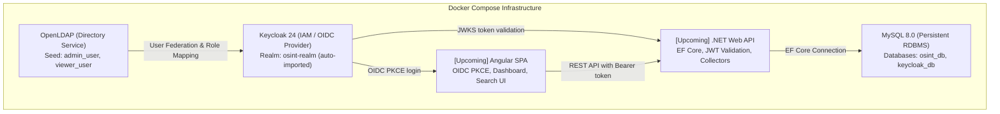

# OSINT Platform MVP

## About the Project
This project is a technical Minimum Viable Product (MVP) for an open-source intelligence (OSINT) platform. The software provides a solid foundation for data collection, persistent storage, and search, while demonstrating the feasibility of the system and extensibility of its architecture.

---

## Architecture Overview



---

## Project Structure & Responsibilities

The codebase follows a strict separation of concerns as mandated by the requirements:

```text
OSINT-MVP/
├── backend/               # .NET Web API, EF Core Data Access, Data Collectors (Upcoming)
│   └── README.md
├── frontend/              # Angular SPA Client, OIDC Authentication, Dashboard UI (Upcoming)
│   └── README.md
├── docker/                # Infrastructure configurations
│   ├── keycloak/          # Keycloak realm export JSON (auto-imported on startup)
│   ├── ldap/              # OpenLDAP seed LDIF (users, groups)
│   └── mysql/init/        # MySQL initialization scripts (databases, privileges)
├── docs/                  # Architecture notes and decision records
│   └── README.md
├── .env.example           # Configuration template with default non-sensitive values
├── docker-compose.yml     # Infrastructure orchestration definition
├── init.ps1               # Automated PowerShell bootstrap and status script
└── README.md              # Project documentation and start guide
```

---

## System Requirements & Resource Allocation

As specified in the assessment requirements, the infrastructure needs the following resources to execute reliably:

### Hardware Requirements
| Resource | Minimum Requirement | Recommended Allocation |
| :--- | :--- | :--- |
| **RAM** | 4 GB | 6–8 GB (allocated to Docker Desktop / WSL2) |
| **CPU** | 2 vCPU Cores | 4 vCPU Cores |
| **Disk Space** | 5 GB free disk space | 10 GB free space (Docker images + volumes) |
| **Operating System** | Windows 10/11 with WSL2, Linux (Ubuntu 20.04+), or macOS |

### Exact Software Versions
* **Docker Engine:** v25+ *(Tested on v29.8.2)*
* **Docker Compose:** v2.20+ *(Tested on Compose v5.6.0)*
* **MySQL:** `8.0`
* **Keycloak:** `24.0.5` (Quarkus runtime)
* **OpenLDAP:** `1.5.0` (slapd)
* **Target .NET SDK:** .NET 9 / 10
* **Target Node.js / Angular:** Node.js v20 / v22 LTS & Angular 18/19

---

## Infrastructure Initialization & Quick Start

### 1. One-Command Setup (PowerShell)
To initialize the `.env` file, start all infrastructure containers, and display running services:

```powershell
.\init.ps1
```

### 2. Manual Start via Docker Compose
Alternatively, using standard Docker commands:

```bash
# 1. Copy environment template if not present
cp .env.example .env

# 2. Start services in background
docker compose up -d

# 3. Check container health status
docker compose ps
```

### 3. Stop or Reset Infrastructure
```bash
# Stop all containers
docker compose stop

# Stop and remove containers, networks, and persistent data volumes (clean reset)
docker compose down -v
```

---

## Services & Endpoints

| Service | Port | Internal Docker Host | URL / Endpoint |
| :--- | :--- | :--- | :--- |
| **Keycloak Admin Console** | `8080` | `keycloak:8080` | [http://localhost:8080](http://localhost:8080) |
| **Keycloak OSINT Realm** | `8080` | `keycloak:8080` | [http://localhost:8080/realms/osint-realm](http://localhost:8080/realms/osint-realm) |
| **OIDC Discovery Endpoint** | `8080` | `keycloak:8080` | [http://localhost:8080/realms/osint-realm/.well-known/openid-configuration](http://localhost:8080/realms/osint-realm/.well-known/openid-configuration) |
| **OpenLDAP Directory** | `389` | `openldap:389` | `ldap://localhost:389` |
| **MySQL Database** | `3306` | `mysql:3306` | `localhost:3306` |

---

## Test Credentials & Roles

All accounts are pre-configured in the Docker seed and automatically imported upon startup:

| Username | Password | Source | Realm Role | Description |
| :--- | :--- | :--- | :--- | :--- |
| `admin_user` | `AdminPassword123!` | **OpenLDAP** | `admin` | Full administrator with privileges to trigger data collectors |
| `viewer_user` | `ViewerPassword123!` | **OpenLDAP** | `viewer` | Read-only viewer for searching and dashboards |
| `local_admin` | `LocalAdmin123!` | **Keycloak Local** | `admin` | Fallback administrator if LDAP is unavailable |
| `local_viewer` | `LocalViewer123!` | **Keycloak Local** | `viewer` | Fallback viewer account |
| `admin` | `admin_password_dev` | **Keycloak Master** | `admin` | Keycloak master administrator |

---

## Demo Environment Simplifications

As requested by the specification (*"Document the demo environment simplifications"*):

1. **HTTP Communication in Dev Mode:** The internal network uses standard HTTP to eliminate the requirement for installing and trusting local self-signed TLS certificates on reviewer machines.
2. **Keycloak Development Mode (`start-dev`):** Runs with single-step automated realm import (`--import-realm`) so the evaluator does not need to manually configure realms, mappers, or clients in the web UI.
3. **Single Database Instance:** A single MySQL 8.0 container hosts both the application database (`osint_db`) and Keycloak database (`keycloak_db`), minimizing host RAM consumption while maintaining isolated database schemas.
4. **Local Fallback User:** To satisfy the requirement of LDAP failure tolerance, `local_admin` is seeded directly into Keycloak's MySQL storage.

---

## Developer Integration Guide

### Backend Layer (.NET Web API)
The .NET backend connects to MySQL and validates Keycloak JWTs:

* **MySQL Connection String:**
  ```text
  Server=localhost;Port=3306;Database=osint_db;User=osint_user;Password=osint_db_password_dev;
  ```
  *(Inside Docker network: `Server=mysql;Port=3306;Database=osint_db;User=osint_user;Password=osint_db_password_dev;`)*

* **OIDC JWT Authentication (`appsettings.json`):**
  ```json
  {
    "Authentication": {
      "Keycloak": {
        "Authority": "http://localhost:8080/realms/osint-realm",
        "Audience": "osint-backend",
        "RequireHttpsMetadata": false
      }
    }
  }
  ```

### Frontend Layer (Angular SPA)
The Angular application uses OIDC PKCE via the pre-configured public client:

* **Keycloak Realm:** `osint-realm`
* **Client ID:** `osint-frontend`
* **Redirect URI:** `http://localhost:4200/*`
* **Flow:** Standard Authorization Code Flow with PKCE (S256)

---

## Automated Testing & CI/CD Pipeline

The project includes automated integration tests that run locally and in GitHub Actions CI:

### 1. Run Tests Locally (PowerShell)
```powershell
.\tests\test-iam.ps1
```

### 2. Run Tests on Linux / Bash
```bash
chmod +x ./tests/test-iam.sh
./tests/test-iam.sh
```

### 3. Continuous Integration (.github/workflows/ci.yml)
Every push and pull request automatically triggers the CI pipeline:
1. Spins up a clean Ubuntu runner.
2. Initializes `.env` from template.
3. Launches the Docker Compose infrastructure.
4. Waits for all services (`mysql`, `openldap`, `keycloak`) to become healthy.
5. Executes the full IAM integration test suite (OIDC discovery, LDAP logins, role mappings, and 401 security rejections).
6. Dumps container logs on any failure and tears down infrastructure.