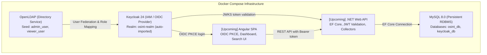

# OSINT Platform MVP

## About the Project
This project is a technical Minimum Viable Product (MVP) for an open-source intelligence (OSINT) platform. The software provides a solid foundation for data collection, persistent storage, and search, while demonstrating the feasibility of the system and extensibility of its architecture.

---

## Architecture Overview



---

## Technology Stack
* **Frontend:** Angular (upcoming layer)
* **Backend:** .NET 9/10 Web API (upcoming layer)
* **Database:** MySQL 8.0 (Entity Framework Core)
* **IAM & Directory:** Keycloak 24.0.5 & OpenLDAP 1.5.0 (OIDC User Federation)
* **Containerization:** Docker & Docker Compose

---

## Infrastructure Initialization & Quick Start

### Prerequisites
* [Docker Desktop](https://www.docker.com/products/docker-desktop/) (v25+ / Docker Compose v2.20+)
* PowerShell 5.1+ (Windows) or Bash (Linux/macOS)

### 1. One-Command Setup (PowerShell)
To initialize the `.env` file, start all infrastructure containers, and display running services:

```powershell
.\init.ps1
```

### 2. Manual Start via Docker Compose
Alternatively, using standard Docker commands:

```bash
# 1. Copy environment template if not present
cp .env.example .env

# 2. Start services in background
docker compose up -d

# 3. Check container health status
docker compose ps
```

### 3. Stop or Reset Infrastructure
```bash
# Stop all containers
docker compose stop

# Stop and remove containers, networks, and persistent data volumes (clean reset)
docker compose down -v
```

---

## Services & Endpoints

| Service | Port | Internal Docker Host | URL / Endpoint |
| :--- | :--- | :--- | :--- |
| **Keycloak Admin Console** | `8080` | `keycloak:8080` | [http://localhost:8080](http://localhost:8080) |
| **Keycloak OSINT Realm** | `8080` | `keycloak:8080` | [http://localhost:8080/realms/osint-realm](http://localhost:8080/realms/osint-realm) |
| **OIDC Discovery Endpoint** | `8080` | `keycloak:8080` | [http://localhost:8080/realms/osint-realm/.well-known/openid-configuration](http://localhost:8080/realms/osint-realm/.well-known/openid-configuration) |
| **OpenLDAP Directory** | `389` | `openldap:389` | `ldap://localhost:389` |
| **MySQL Database** | `3306` | `mysql:3306` | `localhost:3306` |

---

## Test Credentials & Roles

All accounts are pre-configured in the Docker seed and automatically imported upon startup:

| Username | Password | Source | Realm Role | Description |
| :--- | :--- | :--- | :--- | :--- |
| `admin_user` | `AdminPassword123!` | **OpenLDAP** | `admin` | Full administrator with privileges to trigger data collectors |
| `viewer_user` | `ViewerPassword123!` | **OpenLDAP** | `viewer` | Read-only viewer for searching and dashboards |
| `local_admin` | `LocalAdmin123!` | **Keycloak Local** | `admin` | Fallback administrator if LDAP is unavailable |
| `local_viewer` | `LocalViewer123!` | **Keycloak Local** | `viewer` | Fallback viewer account |
| `admin` | `admin_password_dev` | **Keycloak Master** | `admin` | Keycloak master administrator |

---

## Developer Integration Guide

### Backend Layer (.NET Web API)
The .NET backend should connect to MySQL and validate Keycloak JWTs:

* **MySQL Connection String:**
  ```text
  Server=localhost;Port=3306;Database=osint_db;User=osint_user;Password=osint_db_password_dev;
  ```
  *(Inside Docker network: `Server=mysql;Port=3306;Database=osint_db;User=osint_user;Password=osint_db_password_dev;`)*

* **OIDC JWT Authentication (`appsettings.json`):**
  ```json
  {
    "Authentication": {
      "Keycloak": {
        "Authority": "http://localhost:8080/realms/osint-realm",
        "Audience": "osint-backend",
        "RequireHttpsMetadata": false
      }
    }
  }
  ```

### Frontend Layer (Angular SPA)
The Angular application uses OIDC PKCE via the pre-configured public client:

* **Keycloak Realm:** `osint-realm`
* **Client ID:** `osint-frontend`
* **Redirect URI:** `http://localhost:4200/*`
* **Flow:** Standard Authorization Code Flow with PKCE (S256)