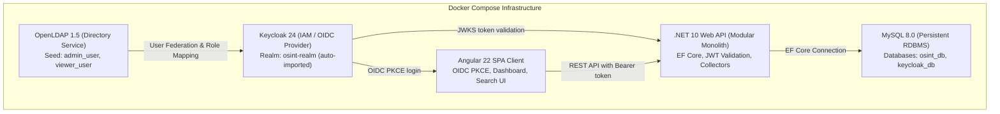

# OSINT Platform MVP

## About the Project
This project is a technical Minimum Viable Product (MVP) for an open-source intelligence (OSINT) platform. The software provides a solid foundation for data collection, persistent storage, and search, while demonstrating the feasibility of the system and extensibility of its architecture.

---

## Architecture Overview



---

## Project Structure & Modular Separation of Concerns

The codebase follows a strict separation of concerns as mandated by the requirements:

```text
OSINT-MVP/
├── frontend/                                   # [1] Presentation Layer (Angular 22 SPA)
│   ├── src/
│   │   ├── app/
│   │   │   ├── core/                           # OIDC/Keycloak auth, interceptors, guards
│   │   │   ├── features/                       # Dashboard, search, collectors views
│   │   │   ├── shared/                         # Reusable UI components & models
│   │   │   ├── app.config.ts
│   │   │   ├── app.routes.ts
│   │   │   └── app.ts                          # Root standalone component
│   │   ├── environments/                       # Environment configurations (API & Keycloak)
│   │   └── styles.scss
│   ├── Dockerfile                              # Multi-stage build (Node 22 -> Nginx Alpine)
│   ├── nginx.conf                              # Nginx reverse proxy & SPA fallback
│   ├── package.json                            # Angular 22.2, RxJS, TypeScript
│   └── README.md
│
├── backend/                                    # .NET 10 Modular Monolith
│   ├── OsintPlatform.sln                       # Standard SLN solution file
│   ├── OsintPlatform.slnx                      # Modern XML solution format (.NET 10)
│   ├── Dockerfile                              # Multi-stage build (.NET 10 SDK -> ASP.NET 10 runtime)
│   ├── README.md
│   └── src/
│       ├── OsintPlatform.Api/                  # [2] Web API Layer
│       │   ├── Controllers/                    # HealthController, REST endpoints
│       │   ├── Program.cs                      # Host configuration, CORS, HealthChecks, OpenAPI
│       │   ├── appsettings.json                # Database and Keycloak configuration
│       │   └── Properties/launchSettings.json  # Dev ports: 5000 (HTTP), 5001 (HTTPS)
│       │
│       ├── OsintPlatform.Core/                 # Shared Domain & Contracts
│       │   ├── Entities/                       # Domain entities
│       │   ├── Interfaces/                     # IDataCollector, IRecordRepository
│       │   ├── DTOs/
│       │   └── Enums/
│       │
│       ├── OsintPlatform.Persistence/          # [3] Data Persistence Layer (EF Core, MySQL)
│       │   ├── Context/                        # OsintDbContext
│       │   ├── Configurations/                 # Fluent API entity configurations
│       │   ├── Repositories/                   # Data access repositories
│       │   └── Migrations/                     # EF Core schema migrations
│       │
│       └── OsintPlatform.Collectors/           # [4] Data Collectors Module
│           ├── Modules/
│           │   ├── FileCollector/              # Sample CSV / JSON file processor
│           │   └── Synthetic/                  # Deterministic synthetic data simulator
│           └── Services/                       # Execution and lifecycle coordinator
│
├── docker/                                     # IAM & database configurations
│   ├── keycloak/                               # Keycloak realm export JSON
│   ├── ldap/                                   # OpenLDAP seed LDIF (users, groups)
│   └── mysql/init/                             # MySQL initialization scripts
├── docs/                                       # [5] System documentation & architecture decisions
│   └── README.md
├── .env.example                                # Environment template (ports, credentials)
├── docker-compose.yml                          # Container orchestration definition (all 5 services)
├── init.ps1                                    # Automated PowerShell bootstrap and status script
└── README.md                                   # Project documentation and start guide
```

---

## System Requirements & Resource Allocation

### Hardware Requirements
| Resource | Minimum Requirement | Recommended Allocation |
| :--- | :--- | :--- |
| **RAM** | 4 GB | 6–8 GB (allocated to Docker Desktop / WSL2) |
| **CPU** | 2 vCPU Cores | 4 vCPU Cores |
| **Disk Space** | 5 GB free disk space | 10 GB free space (Docker images + volumes) |
| **Operating System** | Windows 10/11 with WSL2, Linux (Ubuntu 20.04+), or macOS |

### Exact Software & Framework Versions
* **Docker Engine:** `v25+` *(Tested on v29.8.2)*
* **Docker Compose:** `v2.20+` *(Tested on Compose v5.6.0)*
* **.NET SDK:** `10.0.401` *(Target framework: `net10.0`, C# 13/14)*
* **Angular:** `22.2.3` *(Node.js `v22.23.2` LTS, npm `10.9.8`)*
* **MySQL:** `8.0`
* **Keycloak:** `24.0.5` *(Quarkus runtime)*
* **OpenLDAP:** `1.5.0` *(slapd)*

---

## Platform Quick Start & Running Options

### Option A: Complete Docker Compose Stack (One Command)
To initialize the `.env` file, build backend and frontend images, start all 5 containers, and display service URLs:

```powershell
.\init.ps1
```

Or via standard Docker Compose:
```bash
cp .env.example .env
docker compose up -d --build
docker compose ps
```

### Option B: Local Development Execution

#### 1. Start Infrastructure Only
```bash
docker compose up -d mysql openldap keycloak
```

#### 2. Run .NET Web API Backend
```bash
dotnet run --project backend/src/OsintPlatform.Api --launch-profile http
```
Backend API will be accessible at: `http://localhost:5000`

#### 3. Run Angular Frontend Client
```bash
cd frontend
npm install
npm start
```
Frontend SPA will be accessible at: `http://localhost:4200`

---

## Services & Endpoints

| Service | Port | Internal Docker Host | URL / Endpoint |
| :--- | :--- | :--- | :--- |
| **Frontend Client (Angular SPA)** | `4200` | `frontend:80` | [http://localhost:4200](http://localhost:4200) |
| **Backend API (.NET Web API)** | `5000` | `backend:8080` | [http://localhost:5000](http://localhost:5000) |
| **Backend Health Endpoint** | `5000` | `backend:8080` | [http://localhost:5000/api/health](http://localhost:5000/api/health) |
| **Backend OpenAPI Specification** | `5000` | `backend:8080` | [http://localhost:5000/openapi/v1.json](http://localhost:5000/openapi/v1.json) |
| **Keycloak Admin Console** | `8080` | `keycloak:8080` | [http://localhost:8080](http://localhost:8080) |
| **Keycloak OSINT Realm** | `8080` | `keycloak:8080` | [http://localhost:8080/realms/osint-realm](http://localhost:8080/realms/osint-realm) |
| **OIDC Discovery Endpoint** | `8080` | `keycloak:8080` | [http://localhost:8080/realms/osint-realm/.well-known/openid-configuration](http://localhost:8080/realms/osint-realm/.well-known/openid-configuration) |
| **OpenLDAP Directory** | `389` | `openldap:389` | `ldap://localhost:389` |
| **MySQL Database** | `3306` | `mysql:3306` | `localhost:3306` |

---

## Test Credentials & Roles

All accounts are pre-configured in the Docker seed and automatically imported upon startup:

| Username | Password | Source | Realm Role | Description |
| :--- | :--- | :--- | :--- | :--- |
| `admin_user` | `AdminPassword123!` | **OpenLDAP** | `admin` | Full administrator with privileges to trigger data collectors |
| `viewer_user` | `ViewerPassword123!` | **OpenLDAP** | `viewer` | Read-only viewer for searching and dashboards |
| `local_admin` | `LocalAdmin123!` | **Keycloak Local** | `admin` | Fallback administrator if LDAP is unavailable |
| `local_viewer` | `LocalViewer123!` | **Keycloak Local** | `viewer` | Fallback viewer account |
| `admin` | `admin_password_dev` | **Keycloak Master** | `admin` | Keycloak master administrator |

---

## Demo Environment Simplifications

As requested by the specification (*"Document the demo environment simplifications"*):

1. **HTTP Communication in Dev Mode:** The internal network uses standard HTTP to eliminate the requirement for installing and trusting local self-signed TLS certificates on reviewer machines.
2. **Keycloak Development Mode (`start-dev`):** Runs with single-step automated realm import (`--import-realm`) so the evaluator does not need to manually configure realms, mappers, or clients in the web UI.
3. **Single Database Instance:** A single MySQL 8.0 container hosts both the application database (`osint_db`) and Keycloak database (`keycloak_db`), minimizing host RAM consumption while maintaining isolated database schemas.
4. **Local Fallback User:** To satisfy the requirement of LDAP failure tolerance, `local_admin` is seeded directly into Keycloak's MySQL storage.
5. **Reverse Proxy in Frontend Nginx:** The frontend Nginx container includes an `/api/` reverse proxy pass to `backend:8080`, allowing single-origin evaluation in containerized environments.

---

## Automated Testing & Verification

### 1. Test IAM Infrastructure & OpenLDAP Integration
```powershell
.\tests\test-iam.ps1
```

### 2. Verify Container Health
```bash
docker compose ps
```
All containers (`osint-mysql`, `osint-openldap`, `osint-keycloak`, `osint-backend`, `osint-frontend`) should display `healthy`.